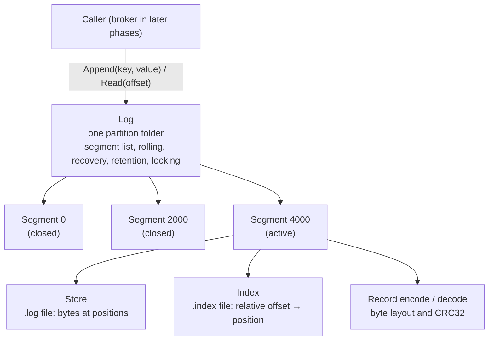
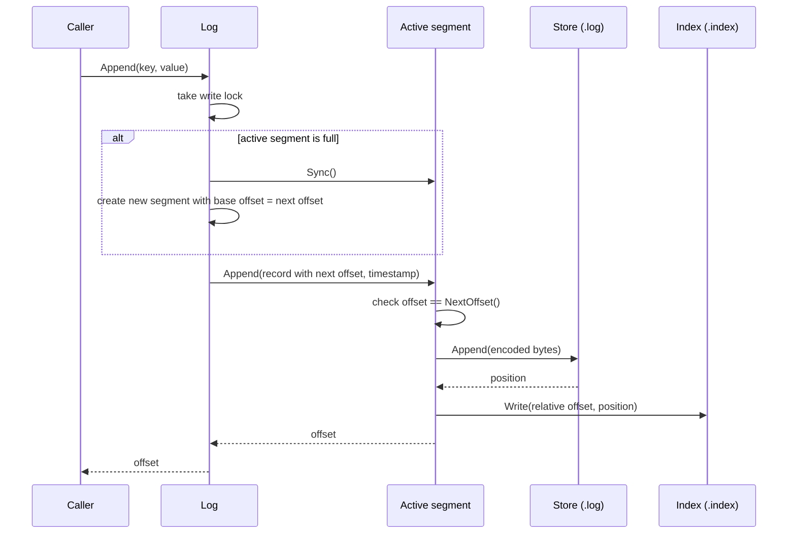
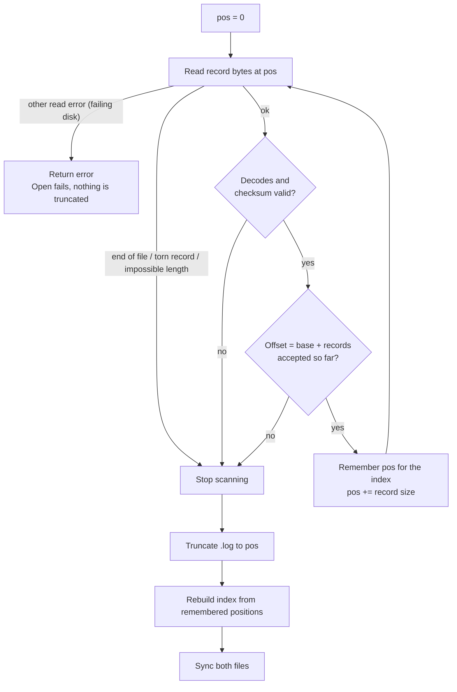

# Storage engine design

This document describes Phase 1 of stream-log: the storage engine that stores one partition's records on disk. Everything else in the project (brokers, replication, consumer groups) is built on top of it.

## Goals

- **Append-only:** records are only ever added at the end. Nothing is modified in place.
- **Fast lookup by offset:** reading offset N should not require scanning earlier records.
- **Crash safety:** after a crash, the log must reopen in a consistent state, keeping every complete record and discarding partial ones.
- **Bounded disk usage:** old data is deleted by age or total size.
- **Concurrency:** many readers at once, alongside a writer.

## Concepts

- **Record:** one message, with a key, a value, a timestamp and an offset.
- **Offset:** a record's position in the partition, counting 0, 1, 2… with no gaps. Offsets are assigned by the log and never reused.
- **Segment:** a chunk of the log stored as a pair of files: a `.log` file holding records and an `.index` file for lookups. Each segment is named after its **base offset**, the offset of its first record.
- **Active segment:** the newest segment, the only one that receives appends. Older segments are closed for writing and never change.

## Architecture

Each layer only talks to the one directly below it.



| Component | File | Responsibility | Knows nothing about |
|---|---|---|---|
| Record | `record.go` | Turns a record into bytes and back; verifies the checksum | Files |
| Store | `store.go` | Appends bytes to the `.log` file; reads one record's bytes at a position | Record fields, offsets |
| Index | `index.go` | Maps relative offsets to byte positions in the `.log` | Record contents |
| Segment | `segment.go` | Keeps one store and one index in step; converts real offsets to relative ones | Other segments |
| Log | `log.go` | Manages the list of segments; assigns offsets; rolling, recovery, retention, locking | Byte layouts |

## On-disk layout

One partition is one folder. Each segment is a `.log` and `.index` pair named by its base offset, zero-padded to 20 digits so that alphabetical order matches numeric order.

```
data/payments-0/
├── 00000000000000000000.log      ← offsets 0 – 1999   (closed)
├── 00000000000000000000.index
├── 00000000000000002000.log      ← offsets 2000 – 3999 (closed)
├── 00000000000000002000.index
├── 00000000000000004000.log      ← offsets 4000 onward (active)
└── 00000000000000004000.index
```

Base offsets are never stored anywhere else: on startup, the log rebuilds its segment list by parsing these filenames.

## Record format

Records are stored in a binary format, big-endian, with a fixed 29-byte header followed by the key and value:

| Position | Size | Field |
|---|---|---|
| 0 | 4 | length of everything after this field |
| 4 | 4 | CRC32 checksum of everything after this field |
| 8 | 1 | format version (currently 1) |
| 9 | 8 | offset |
| 17 | 8 | timestamp, Unix milliseconds |
| 25 | 4 | key length |
| 29 | key length | key |
| 29 + key length | 4 | value length |
| 33 + key length | value length | value |

- The **length prefix** lets a reader know how many bytes to read, and where the next record starts.
- The **checksum** detects corruption and partially written records.
- The **version byte** allows the format to change later without making old data unreadable.
- Storing the **offset inside the record** makes every record self-describing, which recovery relies on.

A record with a 4-byte key and an 8-byte value is 45 bytes on disk.

## The index

The `.index` file is a list of fixed-size 8-byte entries:

| Bytes | Field |
|---|---|
| 0–3 | relative offset (offset − segment base offset) |
| 4–7 | byte position of the record in the `.log` file |

Because every entry is the same size, entry N is at byte `N × 8`, so finding a record's position is a single small read with no searching. Storing **relative** offsets keeps both fields to 4 bytes; positions fit in 4 bytes because segments are capped well below 4 GiB.

The index is a helper, not the source of truth: it can always be rebuilt by scanning the `.log` file, which is exactly what recovery does.

## Writing a record



Two ordering rules matter here:

1. **The `.log` is written before the index.** If a crash happens between the two writes, the log holds a record without an index entry, which recovery fixes by rebuilding the index. The reverse order could leave an index entry pointing at bytes that were never written.
2. **A segment checks the offset before writing anything,** so a record with the wrong offset never reaches the disk.

**Rolling:** before each append, the log checks whether the active segment has reached `MaxSegSize`. If so, it syncs that segment (it will never be written again) and creates a new one whose base offset is the next offset. Segments therefore line up end to end, with no gaps or overlaps. A segment may end up slightly larger than `MaxSegSize`, by at most one record.

## Reading a record

1. Take the read lock.
2. If the offset is at or beyond the next offset to be assigned, return `ErrOffsetOutOfRange`.
3. Find the segment with the largest base offset ≤ the offset, using binary search over the sorted segment list. If the offset is below the first segment's base offset (its data was deleted by retention), return `ErrOffsetOutOfRange`.
4. In that segment: convert to a relative offset, look up the position in the index, read the record bytes from the store, decode and verify the checksum, and check that the decoded offset matches.

Every layer also checks its own bounds (defence in depth), so a bug in one layer produces an error rather than silently returning the wrong record.

## Crash recovery

Only the active segment can have been mid-write when the process stopped; closed segments were synced when the log rolled past them. So on every `Open`, the log scans the active segment from the beginning:



The first invalid record marks where trustworthy data ends; it and everything after it are removed. The scan never tries to skip over a bad record, because once a length field may be corrupt, the start of the next record cannot be known.

Example: the process crashed while writing offset 4003, leaving 20 of its 51 bytes on disk. Recovery accepts 4000–4002, stops at the torn record, truncates the file to the end of 4002, and rebuilds the index with three entries. The next append gets offset 4003. The torn record was never acknowledged to its producer, so nothing acknowledged is lost.

A real disk read error is treated differently from "end of valid data": it is returned, `Open` fails, and the files are left untouched, so a temporary hardware problem cannot cause good records to be deleted.

## Retention

`ApplyRetention` deletes old segments under two rules, applied in order:

- **Age (`MaxAge`):** a segment is deleted when its **newest** record is older than `MaxAge`. Using the newest record means no record is deleted before it has reached the age limit.
- **Size (`MaxTotalSize`):** while the total size of all `.log` files exceeds the limit, the oldest closed segment is deleted.

A limit of zero disables that rule. Both rules follow the same constraints:

- **Only closed segments** are deleted, never the active segment.
- **Only from the front.** Deletion stops at the first segment that is kept for any reason (too young, under the size limit, or an error reading it). Deleting a segment in the middle would leave a gap in the offsets.

Because deletion is always a run at the front, a single counter describes what was removed, and the segment list is updated with one reslice at the end. Afterwards, `LowestOffset()` returns the base offset of the new first segment, and reads of deleted offsets return `ErrOffsetOutOfRange`.

The log gets the current time from `Config.Now` (defaulting to `time.Now`), which lets tests create records that are days old without waiting.

## Concurrency

The log holds a `sync.RWMutex`:

- `Append`, `ApplyRetention` and `Close` take the **write** lock, since they change the segment list or the active segment.
- `Read`, `LowestOffset` and `HighestOffset` take the **read** lock, so any number of readers run in parallel.

Segments, stores and indexes are not safe for concurrent writes on their own; they rely on the log's lock. Reads at the store level use `ReadAt`, which does not share a file cursor, so concurrent reads are safe.

## Durability trade-offs

- Appends are **not** fsynced individually. Data is written to the operating system's page cache, which is fast but means a machine crash (not a process crash) can lose the most recent records.
- The active segment is synced when it rolls, and both files are synced after recovery.
- Distributed log systems such as Kafka make the same trade-off and rely on replication across machines for durability. That is the plan for Phase 5.

## Known limitations and future work

- **Startup time grows with the active segment's size,** because recovery scans it fully. A recovery checkpoint recording how far data is known to be safely on disk would let recovery start from there.
- **Reads make three system calls** (index entry, length prefix, record body). Reading the whole record in one call, or memory-mapping the index, would make reads faster.
- **The index has one entry per record.** A sparse index (one entry every few KB, as Kafka uses) would be much smaller, at the cost of a short scan per lookup.
- **No configurable sync policy** yet, for example syncing every N records or every few milliseconds.
- **`Close` does not sync** the active segment before closing its files.
- **Retention is triggered manually** with `ApplyRetention`; running it on a timer belongs in the broker (Phase 2).
- **No time index** for finding the first offset after a given timestamp.